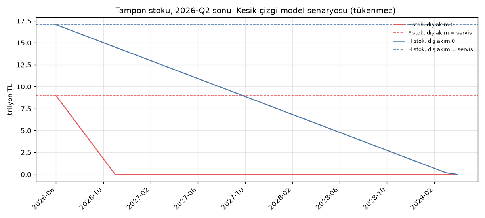

# Veri güncellemesi — 9 Kasım 2026

Çekim günü 9 Kasım 2026. Kaynak, anahtarsız TCMB EVDS3 uç noktası: `https://evds3.tcmb.gov.tr/igmevdsms-dis`. Seri sayfaları `https://evds3.tcmb.gov.tr/tumSeriler/<grup>`. Ham dosyalara yalnız yeni dönem eklendi; 7 Ekim 2026 paneline yazılmış 2026-Q1 hücreleri yerinde durur. Formüller, κ ızgarası, senaryo büyüme ve faiz hedefleri, hane payları ve vade varsayımları değiştirilmedi.

Ayrıntılı çekim dökümü: `veri_guncelleme_log.json`. Ay ay stok: `tampon_tukenme.csv`.

## Envanter ve sonuç

| Seri | Kaynak | Eski son gözlem | Yeni son gözlem | Nerede kullanılır | Durum |
| --- | --- | --- | --- | --- | --- |
| Firma F.4 yükümlülüğü `TP.FINHESTNKS11.ZP34` | EVDS `bie_finhestnks11` | 2026-Q1, 25.339,8 mr TL | 2026-Q2, 27.441,9 mr TL | Adım 3 stoku, faiz durdurma S₀, beş yıl senaryosu | güncellendi |
| 2025 firma F.4 akımı | aynı grup, akım `bie_finhestnks62011` | 4.820,9 mr; GSYH payı %7,62 | 4.812,7 mr; pay %7,61 | `tavan_akis`, kademe itişi | güncellendi (revizyon) |
| Ticari kredi faizi `TP.KTF17` (ortalama) | EVDS `bie_kt100h` | 2026-09, %53,19 | 2026-10, %51,39 | Adım 3 r_t, kriz başlangıç faizi | güncellendi |
| İhtiyaç faizi `TP.KTF10` | aynı | 2026-09, %63,21 | 2026-10, %60,93 | `hane_alt` taşıma kapasitesi | güncellendi |
| AOFM `TP.APIFON4` | EVDS `bie_apifon` | 2026-09, %37,0 | 2026-10 tam ay %36,0; 2026-11 ay içi %36,0 | `faiz_kur_kalibre`, beş yıl faizi | güncellendi |
| TÜFE `TP.TUKFIY2025.GENEL` | EVDS `bie_tukfiy2025` | Eylül yıllık %29,73 | Ekim yıllık %29,77 (endeks 140,77 / 108,48) | beş yıl, kriz enflasyonu, gidişat | güncellendi |
| USD/TRY `TP.DK.USD.A.YTL` | EVDS `bie_dkdovytl` | Eylül civarı | 2026-10 %49,70; 2026-11 ay içi 50,09 | beş yıl döviz tabanı | güncellendi; Kasım ayı kapanmadı |
| Tüketici takip `TP.HPBITABLO6.50` | EVDS `bie_hpbitablo6` (BDDK tablosu) | 2026-09, 372,5 mr TL | 2026-10, 405,2 mr TL | `hane_alt` stres | güncellendi |
| Hane ve firma mevduat / kredi stokları | EVDS konsolide `bie_finhestnks7101x` ve akım grupları | 2026-Q1 | 2026-Q2 eklendi | tampon takvimi, köprü eşlemesi | güncellendi |
| Brüt rezerv `TP.AB.TOPLAM` | EVDS `bie_abres2` | 16.10.2026 civarı (eski metin) | 30.10.2026, 158,1 mr $ | `gidisat_evds` | güncellendi |
| Cari işlemler `TP.ODEAYRSUNUM6` | EVDS | 2026-08 | 2026-08 (Eylül gelmedi) | gidişat | güncellenemedi: yayın yok |
| Merkezi yönetim geliri `TP.KB.GEL001` | EVDS `bie_kbmgel` | 2026-08 | 2026-09 | bütçe kanalı | Eylül eklendi; Ekim yok |
| Birim kira `TP.BK.TR` / `TP.YKKE.TR` | EVDS | 2026-Q3 / 2026-09 | aynı | Adım 5 kira bandı | güncellenemedi: yeni dönem yok |
| Brüt dış borç `bie_brutdbborclu` | EVDS | 2026-Q2 | 2026-Q2 | `dis_borc_ham` | güncellenemedi: 2026-Q3 yok |
| Provizyon `bie_pfvpbi10` | EVDS | 2022-08 | aynı | lambda kalibrasyonu | güncellenemedi: seri uzamıyor |
| `TP.FE25.OKTG01` | EVDS `bie_oktug2025` | gidişatta kullanılıyordu | HTTP 500 | gidişat TÜFE | güncellenemedi; yerine `TP.TUKFIY2025.GENEL` |
| `TP.FG.J0` | EVDS | 2026-01 sonrası dolu değil | 2026-01 | `acik_veri_kopru` TÜFE | güncellenemedi; son ortak ay yıllık %30,65 |
| Swap hariç net rezerv 39,34 mr $ | ikincil, 16.10.2026 | 16.10.2026 | — | kriz KV dış / rezerv | güncellenemedi: depoda seri kodu yok, brüt rezerv ayrı nesne |
| Mevduat faizi %43,30 | ikincil | eski düzey | — | kriz reel mevduat | güncellenemedi: `faiz_ham` içinde mevduat serisi yok |
| BDDK ticari stok 17.302 (2025) | tek-sistem yılı | 2025 | aynı | Adım 3 mutabakat kilidi | durur; 2026 yıl sonu bülteni yok |
| Sektör bilançosu finansman gideri | TÜİK-TCMB xls | 2024 | 2024 | ψ paydası değil, ψ hâlâ 2024 | güncellenemedi: 2025 yayını yok |
| FKDFDVY kısa vadeli döviz tamponu | TCMB xls `FKDFDVY2026-07` | 2026-07 | aynı | HEKİS `hekis.tampon` | güncellenemedi: daha yeni dosya alınamadı |
| BIS hane serisi | OKU notu | 2026-Q1 | — | karşılaştırma cümlesi | güncellenemedi: çekim betiği yok |
| Etki cephesi arşivi | commit kopyası | 2026-10-17 anlığı | — | `etki_cephesi/` | güncellenmedi: bayt kopyası, canlı girdi değil |
| SFC matrisleri `L_v2_2026-Q1` | panel | 2026-Q1 | dosya adı aynı | `akis_model` | Q2 satırları ham dosyada; matris dönemi kodda 2026-Q1 |

2026-Q1 EVDS revizyonu panele yazılmadı. Örnek: firma F.4 konsolide `ZP34` depoda 25.339,8 mr, 9 Kasım çekiminde 25.349,9 mr. Senaryo stoğu bu revizyonun yerine yeni çeyreği kullanır: 2026-Q2, 27.441,9 mr.

## Eşik ve senaryo

Adım 3 kuralı aynı: D_t = κ · u2_t · S₀, I_t = ψ · (r_t / 4) · D_t. ψ = 0,3584 durdu. S₀ 25.339,8 → 27.441,9. r_t son ay %53,19 → %51,39, sonrası gene sabit.

κ = 0,5 için yıllık etkin duran faiz (milyar TL) ve 2024 finansman giderine oranı:

| | 2028 | 2029–2031 |
| --- | ---: | ---: |
| Eski (7 Ekim) | 1.509,6 (0,48×) | 2.415,4 (0,77×) |
| Yeni | 1.579,5 (0,50×) | 2.527,1 (0,80×) |

2024 giderinin üstüne çıkma eşiği değişmedi: κ = 0,5 hâlâ 1×'in altında. κ = 0,25 hâlâ %40 civarı (0,40×), %20 bandına en yakın kalan uç o. κ = 1, 2029'da 1,61×.

Beş yıl enflasyon bandının ucu 7,62 puandan 7,61 puana indi. Geçiş kapısı boş kaldı; tavan hâlâ yazılmıyor.

Kriz takvimi (`analiz/dagitim/adim12345/kriz_zaman`, ufuk 2026-Q4…2030-Q4) yalnız iki eşikte kaydı. Başlangıç faizi %53,19 → %51,39, TÜFE %29,73 → %29,77. Uç faiz hedefleri (40 / 48 / 58) aynı olduğu için yüksek senaryoda başlangıçtan uca çarpan büyüdü.

| Senaryo | Plan | Eşik | Eski ilk aşım | Yeni ilk aşım |
| --- | --- | --- | --- | --- |
| yüksek | S1 erteleme | firma Büyük > %100 | 2028-Q1 | 2027-Q4 |
| yüksek | S1 erteleme | firma Genel > %100 | 2029-Q3 | 2029-Q1 |

Diğer eşikler (TCMB açığı, SYR, kamu faiz/gelir, KV dış/rezerv, reel mevduat, reel senet, beş adım sütunu) aynı çeyrekte. Reel mevduat faizi %43,30 güncellenemediği için o satır eski düzeyle durur.

Adım 1 tavanı 0,0728 / 0,2582, silinen boş, senet `modellenmedi`, üç kapı boş. Koşu etiketi temiz.

2026-Q1 YP payı, revize stok ve kurla 0,5444'ten 0,5441'e indi. Şok testi kararı durur: adım 2 kırılgan / koşullu, adım 3 stres hücresi yayımlanmış faiz gideri bandını aşar.

## Tampon tükenme takvimi

Ufuk, depoda tek bir tampon ufku olarak yazılmıyor. Varsayılan **24 ay** (`odeme_zinciri.T`). Tablo, tükenme daha geçse o aya kadar uzar. Dağılım stresi kendi ufku **6 ay**dır ve o modelde dış akım servisi karşıladığı için agregat stok ay ay azalmaz.

Tanımlar:

- Agregat hane (H) ve firma (F): para ve mevduat varlığı / aylık anapara servisi. Servis = kredi × (kısa pay/12 + (1−kısa pay)/60) + diğer yükümlülük/12. Vade ölçülmemiştir (`odeme_gercek`).
- İki okuma. **Dış akım = servis** (`dagilim_stresi`): stok sabit, tükenmez. **Dış akım 0**: aynı oranın takvimi; stok her ay servis kadar düşer, sıfırı gördüğü ay tükenme ayıdır.
- Ha net: `hane_alt` payları (varlık %5, borç %40). NFP eksi ise net tampon gözlem ayında bitmiş sayılır. Ay ay erime denklemi yok.
- Ha brüt: aynı paylarla mevduat / (borç × 0,35 / 12). %35 `uc_kural_senaryo` varsayımıdır. Ölçülmüş alt kırılım yoktur.
- `alt20_borc_gelir_ay = 2,8` sabittir. 2,5 eşiğinin üstündedir; baştan stresli. Tükenme ayı tanımsız.
- κ = 0,5 anapara servisini değiştirmez. Tampon ayı faiz durdurmadan etkilenmez.
- FX kapsama bir orandır (eski 0,330, 2026-Q2 **0,318**). Ay cinsinden tükenme tanımı yok.
- HEKİS kısa vadeli döviz tamponu yıllıktır; veri 2026-07'de kaldı. Ay yazılmadı.

Gözlem ayı stok çeyreğinin sonudur: eski 2026-03, yeni 2026-06.

| Tampon | Eski ay | Yeni ay | Eski tükenme (dış akım 0) | Yeni tükenme (dış akım 0) | Model senaryosu |
| --- | ---: | ---: | --- | --- | --- |
| H agregat | 33,61 | 33,36 | 2029-01 | 2029-04 | tükenmez |
| F agregat | 5,14 | 5,00 | 2026-09 | 2026-11 | tükenmez |
| Ha net (varsayım pay) | NFP −2,30 tr | NFP −2,50 tr | 2026-03 (zaten eksi) | 2026-06 (zaten eksi) | ay yolu yok |
| Ha brüt (varsayım) | 8,76 | 8,72 | 2026-12 | 2027-03 | dış akım tanımsız |
| alt %20 borç/gelir | 2,8 sabit | 2,8 sabit | tanımsız | tanımsız | baştan eşik üstü |

2026-Q1'den çizilen firma takvimi Eylül 2026'da sıfır diyordu. 2026-Q2 stoku duruyor: aradaki aylarda dış akım servisi karşılamış. Bu, "dış akım = servis" senaryosuyla aynı yönde. Sıfır dış akım takvimi bir süre ölçüsü, gerçekleşmiş bir iflas tarihi değil.

Firma sıfır dış akım yolu (trilyon TL), 2026-Q2 sonundan:

| Ay | Kalan stok | Kalan ay |
| --- | ---: | ---: |
| 2026-06 | 8,98 | 5,00 |
| 2026-07 | 7,19 | 4,00 |
| 2026-08 | 5,39 | 3,00 |
| 2026-09 | 3,59 | 2,00 |
| 2026-10 | 1,79 | 1,00 |
| 2026-11 | 0 | 0 |

Dağılım bandı (lognormal, toplam korunur, `dagilim_stresi` sigma ızgarası). Sıkıntı eşiği 3 ay. p10 tükenmesi gene sıfır dış akım okumasıdır.

| sigma | p10 ay | medyan | p90 | Başlangıçta pay < 3 ay | p10 tükenme | p90 tükenme |
| ---: | ---: | ---: | ---: | ---: | --- | --- |
| 0,15 | 3,91 | 4,89 | 6,34 | 0 | 2026-10 | 2027-01 |
| 0,40 | 2,46 | 4,74 | 8,73 | 0,18 | 2026-09 | 2027-03 |
| 0,70 | 1,40 | 4,45 | 11,20 | 0,29 | 2026-08 | 2027-06 |
| 1,10 | 0,51 | 3,60 | 15,53 | 0,45 | 2026-07 | 2027-10 |

sigma 0,70 ve 1,10'da sıkıntılı pay 6 aylık ufuk boyunca %25'in üstünde (bloke periyot 6). Agregat stok bu ufukta yine azalmaz.

Hane agregat stoku 24 ayın ötesinde, 2029-04'te sıfıra iner (dış akım 0). Tam yol `tampon_tukenme.csv` içindedir.

Kesik çizgi dış akımın servisi karşıladığı yolu gösterir; o yol tükenmez. Düz çizgi stokun yalnız servisle eridiği yoldur.
